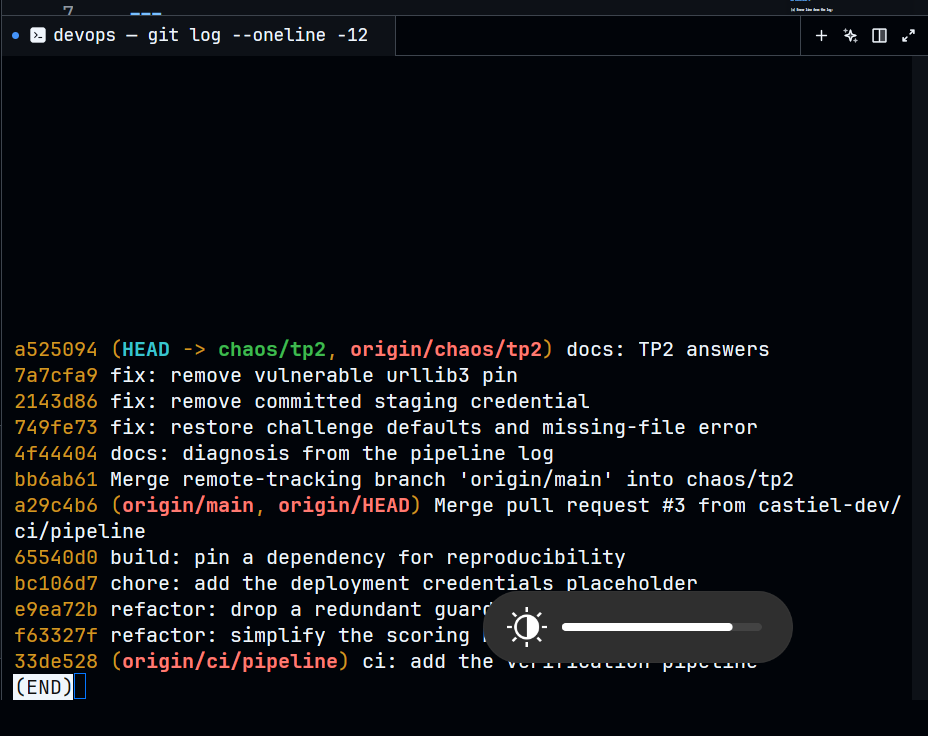
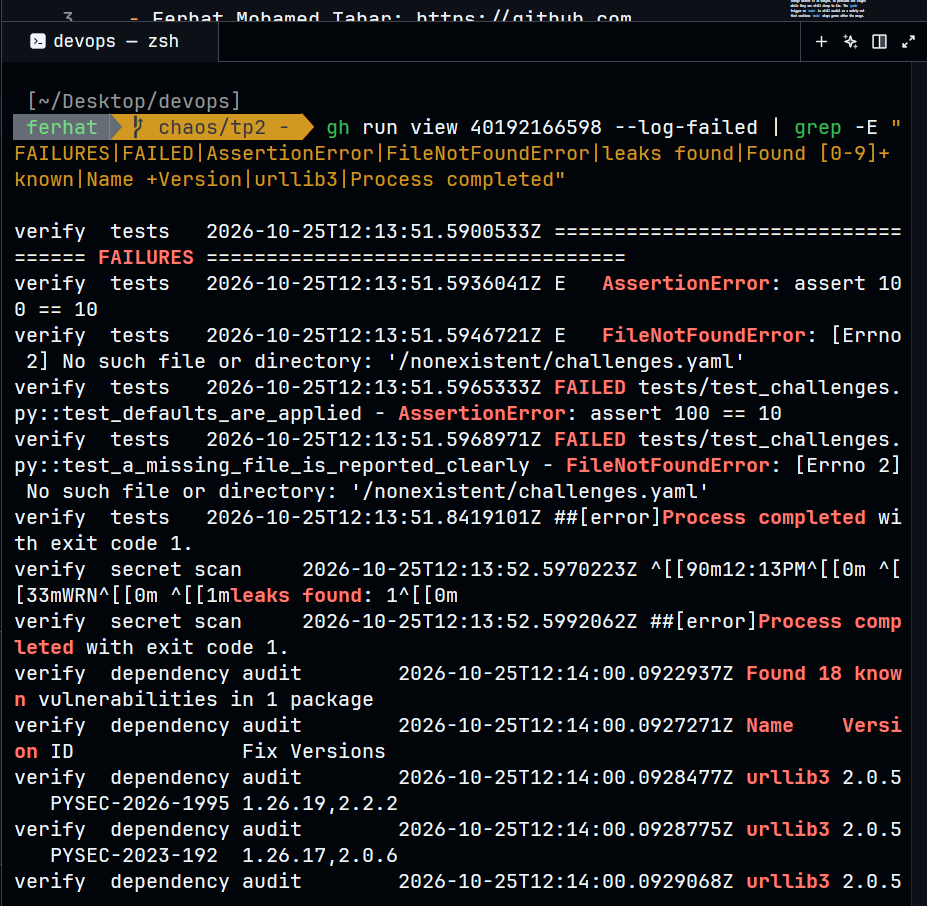
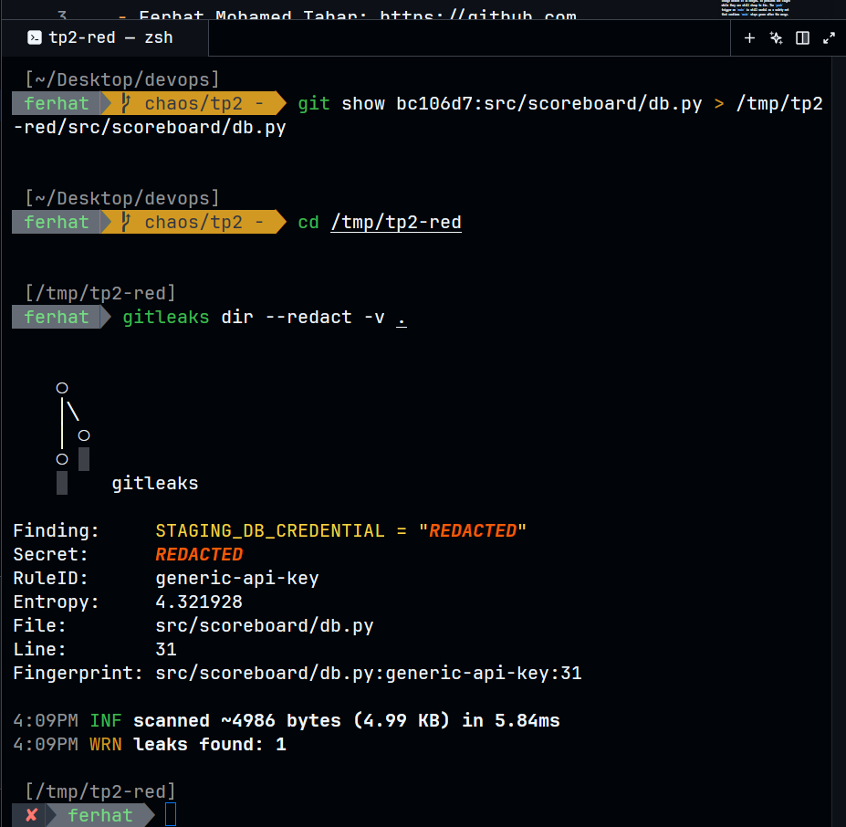
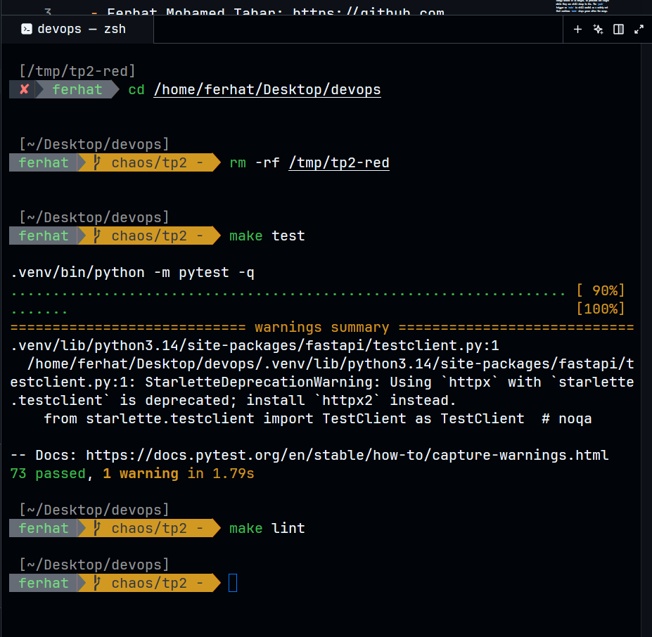
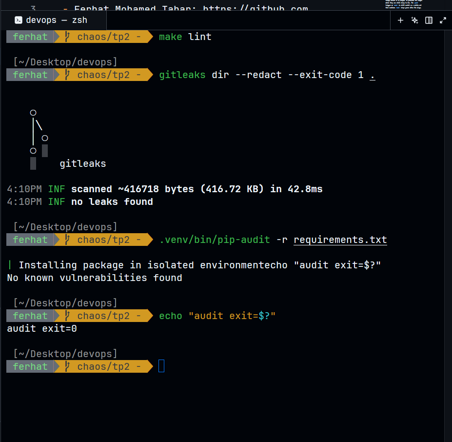
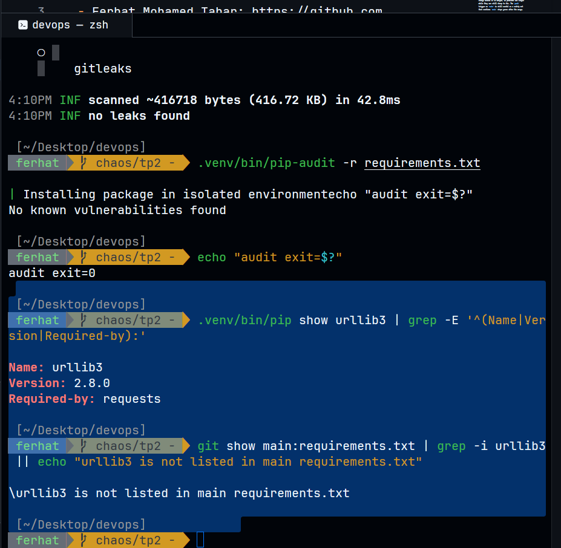
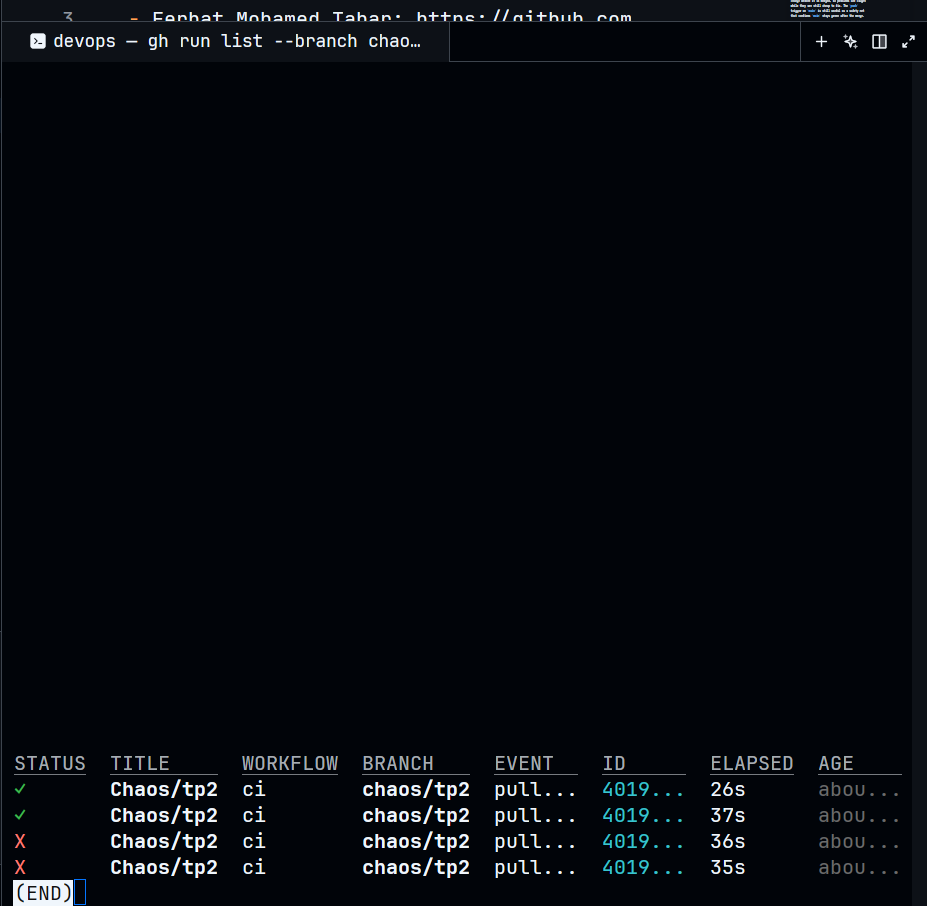
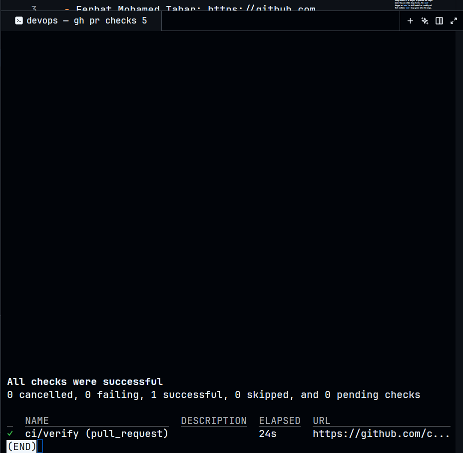
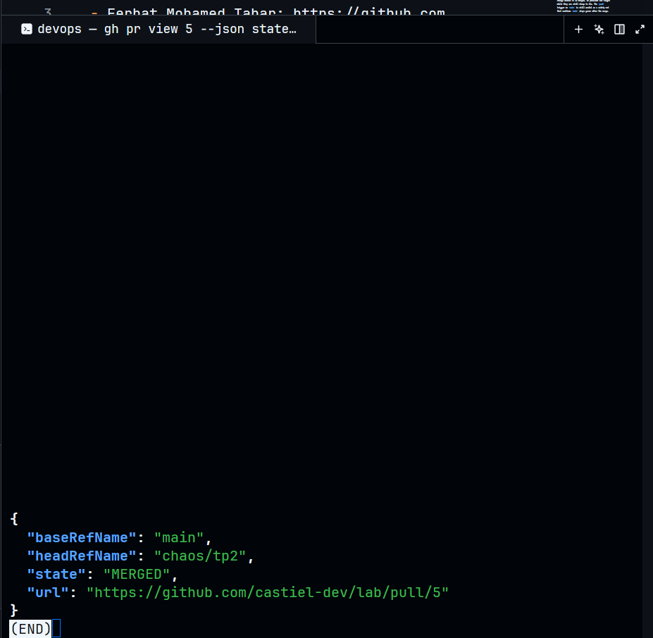

Team Members:

- Ferhat Mohamed Tahar: https://github.com/ferhatmedtahar
- Naoum Ahmed: https://github.com/ahmedsweng
- Omar Chabira: https://github.com/omar-opt

---

# Part A

## Exercise 1

(a) The `push` trigger here is limited to `main`, so it only fires after the code has already landed. `pull_request` runs the pipeline on the proposed change before it is merged, so problems are caught while they are still cheap to fix. The `push` trigger on `main` is still useful as a safety net that confirms `main` stays green after the merge.

(b) Lint is the cheapest gate: it takes seconds, needs no test setup, and catches syntax errors, unused imports and formatting problems. If the code does not pass a basic static check, running the tests is often wasted effort and wasted compute minutes on GitHub.

(c) With a 3-second suite, the order makes almost no difference, since everything finishes almost instantly. With a 20-minute suite, the order decides how long a developer waits to learn about a trivial mistake. A lint failure shows up within a minute, instead of after a 20-minute wait. It also affects runner cost, because every minute spent on a run that was already doomed is paid for.

---

# Part B

## Exercise 2

(a) `git commit --no-verify` skips the pre-commit hook. `git push --no-verify` skips the pre-push hook.

(b) Repository admins can still bypass the rule if "Do not allow bypassing the above settings" is not ticked. Anyone with a bypass permission can too. Someone can also remove the secret scan step from the workflow in the same pull request, unless a reviewer or CODEOWNERS protects `.github/`.

---

# Part C

## Exercise 3

(a) Error line from the log:

`E   ModuleNotFoundError: No module named 'scoreboard'`

It happens in `tests/conftest.py` line 17, at `from scoreboard.app import create_app`. pytest stops with exit code 4 before running any test.

(b) In a src layout, the package is in `src/scoreboard` and not at the root of the repository. Python only looks in the current folder and in the installed packages, so it cannot find `scoreboard` in `src/`. The line `pip install -e .` installs the project in editable mode, so `scoreboard` becomes importable from anywhere. Without it, the import fails even if the code is correct.

(c) `make install`. Its last line in the Makefile is `pip install -e .`.

---

# Part D

## Exercise 4

| Defect     | Gate that failed | Name in the log                                                   | One-line cause |
| ---------- | ---------------- | ----------------------------------------------------------------- | -------------- |
| Test 1     | tests            | `tests/test_challenges.py::test_defaults_are_applied`              | The default `decay_solves` was 100 instead of 10. |
| Test 2     | tests            | `tests/test_challenges.py::test_a_missing_file_is_reported_clearly` | A missing file raised `FileNotFoundError` instead of `ChallengeFileError`. |
| Credential | secret scan      | `generic-api-key` (`src/scoreboard/db.py:31`)                      | A fake `STAGING_DB_CREDENTIAL` was hard-coded in `db.py`. |
| Dependency | dependency audit | `urllib3` 2.0.5 / `PYSEC-2026-1995`                                | `requirements.txt` pinned `urllib3` 2.0.5, which has known vulnerabilities. |

How each test failed:

- Test 1: assertion (`AssertionError: assert 100 == 10`)
- Test 2: exception (`FileNotFoundError: No such file or directory: '/nonexistent/challenges.yaml'`)

---

## Exercise 5

Repairs:

- Fixed the application code in `src/` (no test was changed).
- Removed the secret.
- Undid the change in `requirements.txt`.

(a) The vulnerable package is transitive. It is not written in `requirements.txt` on `main`; it is only installed because another package needs it.

(b) Command: `.venv/bin/pip show urllib3`

The `Required-by: requests` line shows that `requests` needs `urllib3`, so it is a transitive dependency. Running `git show main:requirements.txt | grep -i urllib3` prints nothing, which confirms it is not a direct dependency.

---

# Screenshots of the commands run locally

Every screenshot below shows the command and its output. They are in the order the commands were run.

### 1. Branch and commit order

The diagnosis commit comes before the three fix commits.

### 2. Red pipeline log

This is the failed log of run `40192166598`, covering the two test failures, the secret scan and the dependency audit.

### 3. Secret scan rule and location

This reproduces the gitleaks finding on the seeded commit. The secret itself is redacted.

### 4. Tests and lint after the fixes

`make test` reports 73 passed. `make lint` prints nothing and exits with status 0.

### 5. Secret scan and dependency audit after the fixes

`gitleaks` reports no leaks and `pip-audit` reports no known vulnerabilities.

### 6. Direct or transitive dependency

`urllib3` is required by `requests` and is not listed in `requirements.txt` on `main`, so it is transitive.

### 7. Remaining final checks

These are the remaining screenshots of the final checks, in the order they were taken.

